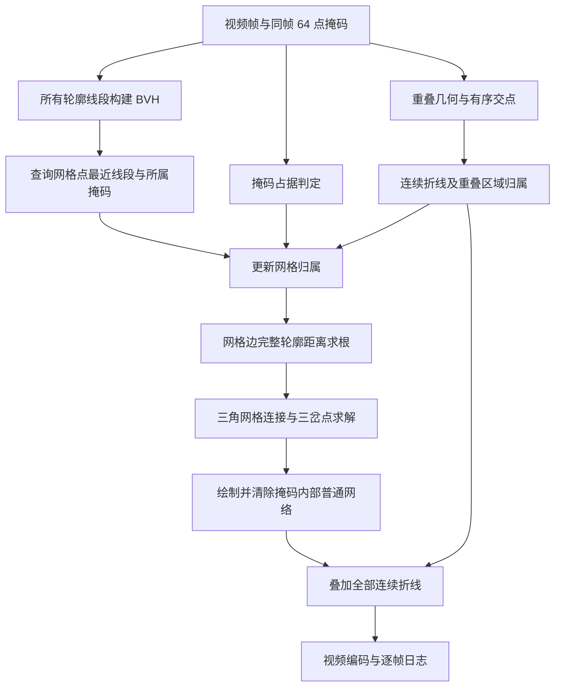

# 算法逻辑与效率来源

## 1. 几何对象

一个掩码由按轮廓顺序排列的 64 点表示，最后一点与第一点相连。计算使用所有 64 条连续线段，不把轮廓简化成 6 点，也不把轮廓顶点当成相互独立的维诺站点。

对掩码外的查询点 q，多边形边界距离为：

```text
t = clamp(dot(q-a, b-a) / dot(b-a, b-a), 0, 1)
d(q, segment[a,b]) = length(q - (a + t*(b-a)))
d(q, polygon P) = min over every segment of P
owner(q) = argmin over polygons of d(q, P)
```

零长度线段按一个点处理。掩码内部单独进行占据判定；内部不使用“到边界的距离”来争夺普通外部分区，否则可能出现围绕自身掩码的错误内部小环。

当前缓存每个掩码只有一个有序闭合轮廓，不表达多个独立轮廓或显式孔洞。自交轮廓的点内外判定采用奇偶规则。

## 2. 完整处理流程



### BVH 最近线段查询

`bvh_field.py` 将所有轮廓线段组织成轴对齐包围盒树。按线段中心分布递归划分，叶节点默认包含最多 8 条线段。查询先访问更近的子树；当包围盒距离下界大于当前最优值时，跳过整棵子树。

叶节点使用连续线段的距离公式。所有对象的线段一起搜索，得到最近线段后映射回掩码编号，不再生成每个掩码一整张稠密距离图。等距时以较小线段索引确定归属。原轮廓先保持缓存的 float32 坐标，再以 float64 进行线段查询。

这改变了距离计算的组织方式：从大量逐对象、逐线段的计算，变为带空间剪枝的最近邻查询。Numba 编译树构建和查询循环，查询在 4 个线程上并行。BVH 的最坏情况仍可能退化为遍历全部线段，不能把平均剪枝效果当成严格的对数复杂度保证。

### 占据、求根与网络连接

网格 `scale=0.5`，即每 2 个原图像素设置一个查询点。该设置减少的是空间查询网格数量，不减少掩码的 64 点轮廓。

1. 点在掩码内部时，将网格归属设为占据它的掩码；重叠处再依据约定分区更新归属。
2. 对归属发生变化的水平、竖直和对角网格边，解 `d(q,A)-d(q,B)=0`。
3. 每次距离计算扫描对应掩码的全部线段，允许最近线段在求根过程中切换。二分迭代 20 次。
4. 每个网格方格拆成两个三角形，共享网格边交点。两类对象的三角形连接对应交点；三类对象使用有界、阻尼 Newton 迭代求三岔点，最多 50 次迭代。
5. 按原图分辨率绘制 2 像素宽线条，清除掩码内部普通网络，再绘制重叠折线。

这避免了旧流程中固定两个候选线段求根，以及仅按交点距离随意连线的问题。不过网格仍可能漏掉很小的区域，求根和三岔点求解也存在失败情况。

## 3. 重叠区域：全部交点连续连接

本规则是用户指定的重叠分割约定。在实体掩码相交的区域内，两者到实体的距离都为零，单纯最近距离不能唯一决定归属。

### 找出交点并排序

先用包围盒排除不相交对象，再通过 Shapely 计算正面积重叠和边界交点。对各交点计算它在原轮廓上的累计弧长，并沿轮廓排序。将闭环在最大的交点间弧长空隙处断开，得到开放序列；以端点坐标字典序统一序列方向。

两个掩码分别执行排序，序列需一致。得到 n 个交点后绘制 n−1 条线段：

```text
2 点：1—2
4 点：1—2—3—4
6 点：1—2—3—4—5—6
```

不只连接最外侧两个点，不按 1–2 / 3–4 分组，也不连接最后一点回第一点。对于凹形重叠，连续线段可能短暂离开重叠区域；当前实现保留完整折线，没有把它剪成多个断段。

### 划分重叠区域的归属

将折线首尾两段沿原方向延长，用完整折线切开重叠多边形。对各子区域，比较它与 A 的独占区域、B 的独占区域相邻边界的长度，归给相邻较多的一方。两者几乎相等时记录歧义。正好落在分界线上的网格点归较小对象索引。

该区域归属参与网格拓扑；显示时另行绘制完整约定折线，所以不会被“清除掩码内部普通网络”的步骤抹掉。

### 自交轮廓

平滑后的部分轮廓有细小自交，直接对其执行多边形布尔运算可能失败。当前用 Shapely `make_valid` 的 linework 方式对布尔运算几何建立合法面，保留原边线并采用奇偶填充。

距离计算仍使用未修改的 64 点；交点排序仍投影到原轮廓。修复不是减点、重新检测或替换原掩码，相关对象会记录在 `geometry_repairs`。

## 4. 效率配置

| 层次 | 当前实现 |
|---|---|
| 计算组织 | BVH 剪枝，只求最近对象，省去每对象稠密距离场 |
| 数值循环 | Numba 编译距离、占据、求根和连接循环 |
| 单帧内 | BVH 查询和网格边求根使用 Numba 并行循环 |
| 帧之间 | 默认 3 个独立进程，按帧顺序收集结果 |
| 内存 | 待处理队列最多约 `2 × workers` 帧，避免整片解码后排队 |
| 线程控制 | 每个进程 BVH 设置 4 线程，OpenCV/BLAS 限制为 1 线程 |
| 编码 | FFmpeg/libx264，4 线程、fast、CRF 18、yuv420p |

此版未实现 GPU 内核。CPU 当前已能完成本例处理；GPU 并非必需依赖。

## 5. 结果等价的边界

保留全部线段和使用 BVH，不等于复刻旧实现的所有浮点位模式。当前线段距离查询基于原坐标和 float64 距离，按明确索引规则处理等距；与旧 BLAS 计算可能存在舍入差异。

此外，实体占据、完整轮廓求根、拓扑连接和用户指定重叠折线有意修正了旧绘制逻辑，所以新版与旧图像不应要求逐像素一致。原实验中“严格兼容优化”与这里的“新绘制逻辑”是两套不同实验，不应混用加速倍数和一致性结论。

本次代码整理以新逻辑的全片版本为基准；打包后的 6 个真实帧与原全片未压缩 PNG 做逐像素比较，检查结果见 `tests/package_validation.json`。

## 6. 已知限制与日志含义

| 字段或状态 | 含义及处理 |
|---|---|
| `contour_order_disagrees` | 两个轮廓给出的交点顺序不同，跳过该重叠分界 |
| `triple_overlap` | 存在第三个掩码与当前重叠区域正面积相交，当前没有联合分配规则 |
| `needs_rule_for_crossings_or_containment` | 包含、共享边或不足两个可用交点，无法套用当前折线规则 |
| `self_crossing_interface` | 拟连接折线会自交，跳过 |
| `ambiguous_side_assignment` | 分块的两侧归属无法唯一确定，跳过 |
| `invalid_polygon` | 无法取得有效多边形几何，记录问题 |
| `failed_junctions` | 三岔点未收敛，略去该局部线段 |
| `unbracketed_crossings` | 网格边上的两端值未夹住根，略去对应连接 |
| `required_polyline_missing_pixels` | 已生成的约定折线在未压缩网络中缺失的像素数，必须为 0 |

异常只影响相关局部，视频帧仍正常输出。程序不会删除相关对象来掩盖问题，也不会在这些歧义处随意补线。当前没有时间维度上的网络拓扑稳定约束，轮廓平滑不能保证网络完全不闪动。
